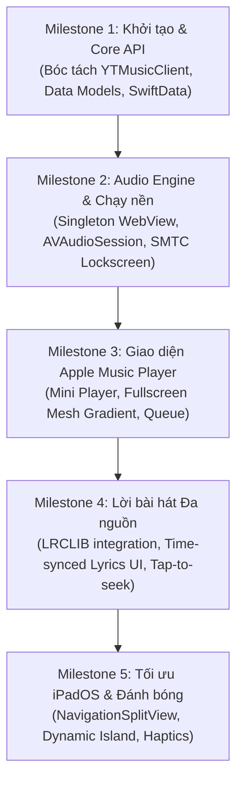

# Master Plan: Oto (音) - Native iOS & iPadOS Music Client

> **Tên chính thức:** **Oto** (tiếng Nhật: 音 - Âm thanh)  
> **Mục tiêu cốt lõi:** Một trình phát nhạc YouTube Music native 100% dành cho iOS và iPadOS với ngôn ngữ thiết kế tối giản, trải nghiệm phát nhạc đẳng cấp tương tự **Apple Music Player** và hệ thống lời bài hát đồng bộ đa nguồn.

---

## 1. Định vị & Triết lý Thiết kế

* **Trải nghiệm hàng đầu (Apple Music Experience):** Giao diện phát nhạc đẳng cấp với hiệu ứng nền vệt màu chuyển động theo bìa album (*Animated Dynamic Mesh Gradient*), Mini-Player trượt mở mượt mà, thao tác cử chỉ tự nhiên (gesture-driven).
* **Lời bài hát đồng bộ đa nguồn (Multi-Source Synced Lyrics):** Khắc phục điểm yếu lớn nhất của YouTube Music (ít bài có lyric chạy theo nhạc) bằng cách kết hợp kho lyric thời gian thực từ nhiều nhà cung cấp (LRCLIB, Musixmatch, YouTube Music).
* **Hiệu năng & Tiết kiệm Pin:** 100% Native SwiftUI, tải dữ liệu trực tiếp từ Innertube JSON API (không tải giao diện web nặng nề), tối ưu hóa luồng phát nền (*Background Audio*).
* **Đa nền tảng di động Apple:** Tối ưu song song cho iPhone (giao diện 1 tay, Dynamic Island) và iPad (Sidebar `NavigationSplitView`, chế độ hiển thị song song Player + Lyrics toàn màn hình).

---

## 2. Ngôn ngữ & Stack Công nghệ Đề xuất

| Thành phần | Công nghệ / Framework | Lý do lựa chọn |
| :--- | :--- | :--- |
| **Ngôn ngữ** | **Swift 6.0** (Strict Concurrency Checking) | Tận dụng an toàn luồng dữ liệu (Data Race Safety), Actor model, `@Observable`, async/await. |
| **UI Framework** | **SwiftUI** (Target: iOS 17.0+ & iPadOS 17.0+) | Hiện đại, làm animation mượt 120Hz ProMotion, hỗ trợ Native MeshGradient (iOS 18) và Canvas Shader. |
| **Giao tiếp Hệ điều hành** | `MediaPlayer`, `AVFoundation`, `ActivityKit` | Tích hợp sâu: Khóa màn hình (Lock Screen), Control Center, Tai thỏ / Dynamic Island (Live Activities), AirPods gesture. |
| **Trình phát & DRM** | `WKWebView` (Singleton Headless) + `AVAudioSession` | Giải quyết bài toán bản quyền Widevine DRM cho tài khoản YouTube Music Premium mà không lo bị Google chặn stream. |
| **Lưu trữ Cục bộ** | `SwiftData` + `KeychainAccess` | Lưu danh sách yêu thích, lịch sử nghe, cache metadata bài hát và lưu cookie đăng nhập an toàn trong Keychain. |
| **Network & Parsing** | `URLSession` + Swift `Codable` | Thuần Swift, không phụ thuộc thư viện bên ngoài; tận dụng lại các parser đã hoàn thiện từ Kaset macOS. |
| **Lyrics Engine** | **LRCLIB API** (Chính) + **Musixmatch/YTM** (Dự phòng) | LRCLIB là API cộng đồng mở, miễn phí, chuyên cung cấp time-synced lyric `.lrc` cực chuẩn. |

---

## 3. Kiến trúc Hệ thống (System Architecture)

```
┌────────────────────────────────────────────────────────────────────────┐
│                      PRESENTATION LAYER (SwiftUI)                      │
│   ├── iPhone: TabView (Home, Explore, Library, Search) + Floating Bar  │
│   ├── iPadOS: NavigationSplitView (Sidebar + Dual-Pane Content)         │
│   └── NowPlaying: Animated Mesh Gradient + Interactive Synced Lyrics    │
└───────────────────────────────────┬────────────────────────────────────┘
                                    │ (Observation / @Observable)
┌───────────────────────────────────▼────────────────────────────────────┐
│                    VIEWMODELS & APPLICATION LOGIC                      │
│   ├── PlayerViewModel (State, Time scrubbing, Queue, Volume)           │
│   ├── LyricsViewModel (Multi-source fetcher, time sync interpolation)   │
│   ├── HomeViewModel / ExploreViewModel / LibraryViewModel              │
│   └── AuthViewModel (Google login sheet & cookie lifecycle)            │
└──────────────┬──────────────────────────────────────────┬──────────────┘
               │                                          │
┌──────────────▼─────────────┐             ┌──────────────▼──────────────┐
│       DATA & API CORE      │             │     AUDIO & PLAYBACK CORE   │
│ ├── YTMusicClient          │             │ ├── SingletonPlayerWebView  │
│ │   ├── HomeParser         │             │ ├── AudioSessionManager     │
│ │   ├── ExploreParser      │             │ ├── NowPlayingManager (SMTC)│
│ │   └── PlaylistParser     │             │ └── BackgroundKeeper        │
│ ├── LyricsService (LRCLIB) │             └──────────────┬──────────────┘
│ └── SwiftData Storage      │                            │
└────────────────────────────┘                            ▼
                                           ┌─────────────────────────────┐
                                           │ iOS System Integration      │
                                           │ (Dynamic Island, AirPlay,   │
                                           │  Lock Screen Controls)      │
                                           └─────────────────────────────┘
```

---

## 4. Các "Điểm Chặn" Kỹ thuật & Rủi ro Cốt lõi (Critical Guardrails)

Trong phát triển app nghe nhạc trên iOS/iPadOS, có 5 "hố sâu" kỹ thuật cần phải chặn đứng ngay từ thiết kế ban đầu:

### Điểm chặn 1: iOS Background Audio Suspension (Tắt màn hình bị ngắt nhạc)
* **Vấn đề:** iOS quản lý RAM và năng lượng cực gắt. Nếu một `WKWebView` chạy ngầm, sau 30-60 giây hệ điều hành sẽ tự động "đóng băng" (suspend) tiến trình WebKit để tiết kiệm pin, dẫn đến nhạc bị dừng đột ngột.
* **Biện pháp xử lý:**
  1. Đăng ký `UIBackgroundModes: ["audio"]` trong `Info.plist`.
  2. Kích hoạt `AVAudioSession.sharedInstance().setCategory(.playback, mode: .default, policy: .longFormAudio)`.
  3. Bật cờ `configuration.allowsInlineMediaPlayback = true` trên `WKWebView`.
  4. Duy trì một silent audio track hoặc kết nối Native Audio Session để bảo toàn quyền ưu tiên tiến trình cho app.

### Điểm chặn 2: Rò rỉ Bộ nhớ (Memory Leak) từ WebView
* **Vấn đề:** Mỗi lần đổi bài nếu khởi tạo lại WebView hoặc load lại trang web HTML đầy đủ sẽ khiến RAM tăng vọt từ 80MB lên 400MB+, dẫn đến việc iOS ép dừng ứng dụng (`Jetsam Event` - Crash do OOM).
* **Biện pháp xử lý:**
  - Áp dụng triệt để mô hình **Singleton Player WebView**: Chỉ nạp DOM một lần duy nhất khi mở app.
  - Chuyển bài bằng cách gọi JavaScript function (`player.loadVideoById(id)`) thay vì tải lại toàn bộ trang web.
  - Vô hiệu hóa load hình ảnh, CSS rườm rà trong Player WebView bằng Content Blockers (chỉ để lại Core Audio Player).

### Điểm chặn 3: Sự thay đổi cấu trúc của YouTube Innertube API
* **Vấn đề:** YouTube liên tục cập nhật schema JSON của Innertube không báo trước. Parser viết cứng sẽ làm app crash hoặc hiển thị màn hình trắng.
* **Biện pháp xử lý:**
  - Áp dụng nguyên tắc **Graceful Degradation**: Mọi trường trong parser đều phải là `Optional` hoặc có giá trị mặc định an toàn.
  - Phân tách tầng Network Wire Data và Presentation Data Model.
  - Bổ sung Unit Tests kiểm tra tính toàn vẹn của các JSON fixtures thực tế.

### Điểm chặn 4: An toàn Dữ liệu & Chứng chỉ Google (Zero-Credential Leak)
* **Vấn đề:** Rò rỉ token `SAPISID` hoặc Cookie đăng nhập của người dùng.
* **Biện pháp xử lý:**
  - Không bao giờ in Cookie hoặc Authorization header ra `print()` hoặc `os_log`.
  - Lưu cookie vào `WKHTTPCookieStore` và mã hóa backup trong **iOS Keychain** với `kSecAttrAccessibleAfterFirstUnlock`.

### Điểm chặn 5: Đồng bộ Lời bài hát mượt mà (Lyrics Drift & Jitter)
* **Vấn đề:** Web player trả về tiến độ thời gian (playback progress) với độ trễ (delay 250ms–500ms), khiến lời bài hát nhảy giật cục thay vì cuộn êm.
* **Biện pháp xử lý:**
  - Dùng bộ nội suy thời gian (`CADisplayLink` hoặc `TimelineView` trong SwiftUI) để mượt hóa số giây hiện tại giữa các lần nhận tín hiệu từ Player.

---

## 5. Yêu cầu Nghiệp vụ Chi tiết (Detailed Requirements)

### Phân hệ 1: Xác thực & Tài khoản (Authentication)
1. **Chế độ Guest (Khách):** Cho phép nghe nhạc, tìm kiếm, khám phá các bảng xếp hạng mà không bắt buộc phải đăng nhập.
2. **Đăng nhập Google:** Mở `WKWebView` đăng nhập chuẩn của Google. Tự động trích xuất cookie session, lưu vào Keychain và kích hoạt các tính năng cá nhân hóa (Thư viện cá nhân, Playlist, Liked Music).

### Phân hệ 2: Khám phá & Thư viện (Discovery & Library)
1. **Home Feed:** Hiển thị kệ nhạc cá nhân (*Listen Again*, *Quick Picks*, *Mixed for you*, *Similar to...*).
2. **Explore:** Bảng xếp hạng (*Charts*), Thể loại & Tâm trạng (*Moods & Genres*), Bài hát mới phát hành (*New Releases*).
3. **Thư viện (Library):** Danh sách bài hát đã thích (*Liked Songs*), Album đã lưu, Playlist cá nhân, Nghệ sĩ đang theo dõi.
4. **Tìm kiếm (Search):** Gợi ý từ khóa tự động (*Search Suggestions*), bộ lọc kết quả (Bài hát, Album, Nghệ sĩ, Playlist).

### Phân hệ 3: Trình phát Nhạc (Apple Music-Style Player)
1. **Mini Player:**
   - Nằm nổi phía trên thanh Tab Bar.
   - Hiển thị bìa album bo tròn, tên bài hát, nghệ sĩ, thanh tiến độ mảnh và nút Play/Pause/Next.
   - Hỗ trợ cử chỉ vuốt để chuyển bài hoặc kéo lên để bung ra Fullscreen Player.
2. **Fullscreen Now Playing:**
   - **Nền:** Dynamic Mesh Gradient chuyển động chậm theo bảng màu trích xuất từ bìa album bài hát đang phát.
   - **Bìa Album:** Phóng to ở giữa, có hiệu ứng nảy nhẹ khi Play/Pause (tương tự Apple Music trên iOS 17/18).
   - **Thanh điều khiển:** Scrubbing trượt mượt mà hiển thị thời gian đã phát và thời gian còn lại, điều khiển âm lượng, nút Shuffle & Repeat.
   - **Hàng đợi (Queue):** Xem danh sách bài sắp phát, kéo thả sắp xếp lại thứ tự, vuốt để xóa, nút kích hoạt Smart Shuffle.

### Phân hệ 4: Hệ thống Lời bài hát Đa nguồn (Multi-Source Lyrics Engine)
1. **Cơ chế truy vấn phân tầng (Hierarchical Resolution):**
   - **Bước 1:** Lấy ISRC hoặc kết hợp `Tên bài hát + Tên nghệ sĩ + Thời lượng` gửi đến **LRCLIB**. Nếu có time-synced lyric -> Hiển thị dạng hát karaoke.
   - **Bước 2:** Nếu LRCLIB không có -> Gọi API **Musixmatch** (token công khai hoặc client scraper).
   - **Bước 3:** Nếu vẫn không có -> Lấy lyric dạng văn bản tĩnh (plain text) từ YouTube Music.
2. **Giao diện Lời bài hát:**
   - Chữ to, rõ ràng, làm mờ các câu chưa đến lượt.
   - Dòng đang hát sẽ nổi bật, phóng to nhẹ và đổi màu sáng.
   - Nhấn vào bất kỳ câu nào để chuyển ngay tiến độ bài hát tới đoạn đó (*Tap to seek*).

### Phân hệ 5: Tối ưu cho iPadOS (iPad Experience)
1. Cấu trúc `NavigationSplitView` chuẩn:
   - Cột 1 (Sidebar): Truy cập nhanh Trang chủ, Khám phá, Thư viện, Playlists.
   - Cột 2 (Content View): Lưới album, bài hát hiển thị tối ưu cho màn hình rộng.
2. Chế độ Player toàn màn hình trên iPad:
   - Chia 2 cột: Bên trái là Bìa album khổ lớn và thanh điều khiển; Bên phải là Lời bài hát cuộn song song.

---

## 6. Lộ trình Triển khai Dự án (Milestones)



* **Giai đoạn 1 (Tuần 1 - Foundation):**
  - Tạo Xcode Project (Universal iOS & iPadOS).
  - Tách và chuyển các file Core từ Kaset macOS sang: `YTMusicClient`, `Parsers`, `Models`.
  - Viết Unit Tests với Swift Testing xác nhận API parse dữ liệu chuẩn xác trên iOS Simulator.
* **Giai đoạn 2 (Tuần 2 - Audio Playback):**
  - Dựng `PlayerWebView` chạy nền, thiết lập `AVAudioSession`.
  - Đảm bảo khóa màn hình nhạc vẫn phát, điều khiển Play/Pause/Skip từ Lock Screen và AirPods thành công.
* **Giai đoạn 3 (Tuần 3 - Player & UI Experience):**
  - Dựng giao diện Home & Search với SwiftUI.
  - Xây dựng Mini Player và Fullscreen Now Playing với Mesh Gradient.
* **Giai đoạn 4 (Tuần 4 - Lyrics Engine):**
  - Tích hợp LRCLIB API client.
  - Xây dựng View cuộn lời bài hát đồng bộ thời gian thực theo tiến độ nhạc.
* **Giai đoạn 5 (Tuần 5 - iPadOS & Final Polish):**
  - Bổ sung layout 2 cột cho iPadOS.
  - Tinh chỉnh haptic feedback, animation, kiểm tra memory leak và đóng gói bản TestFlight/Sideload.
